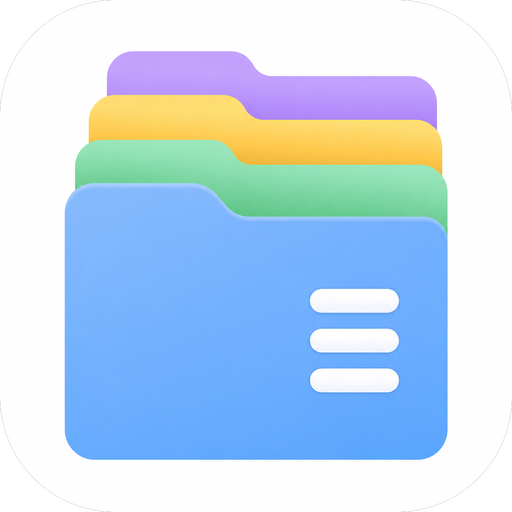
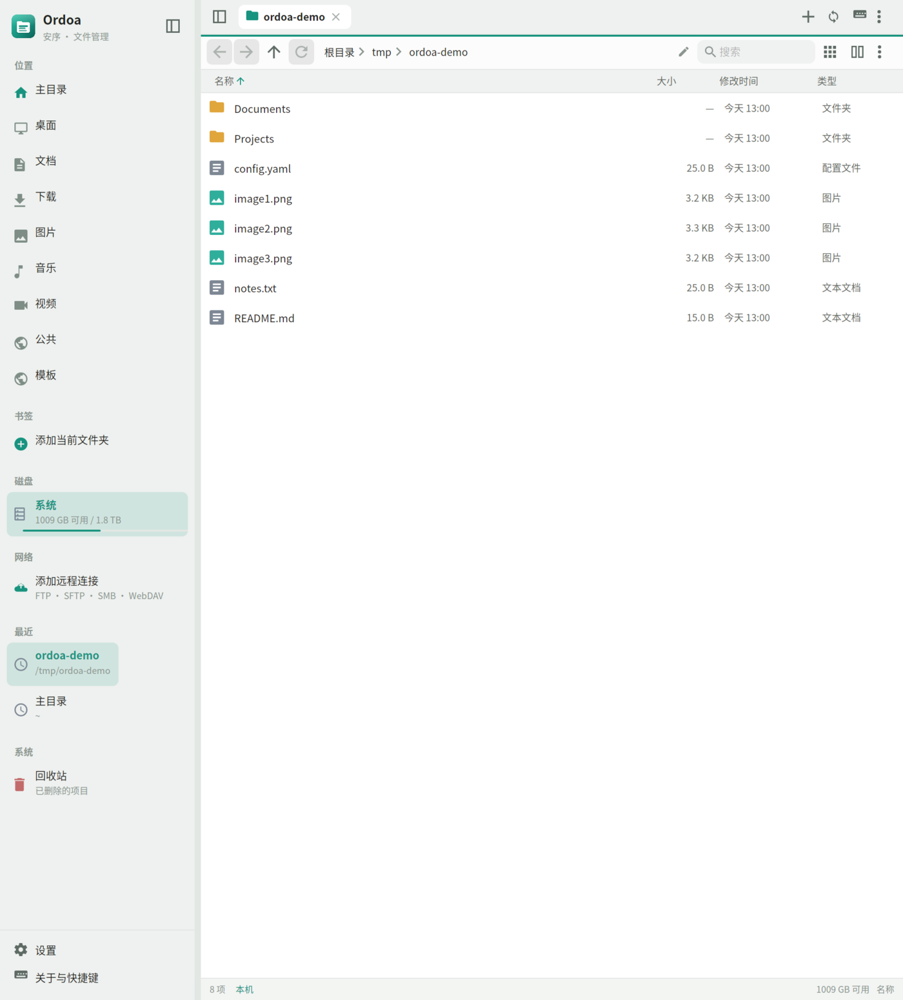
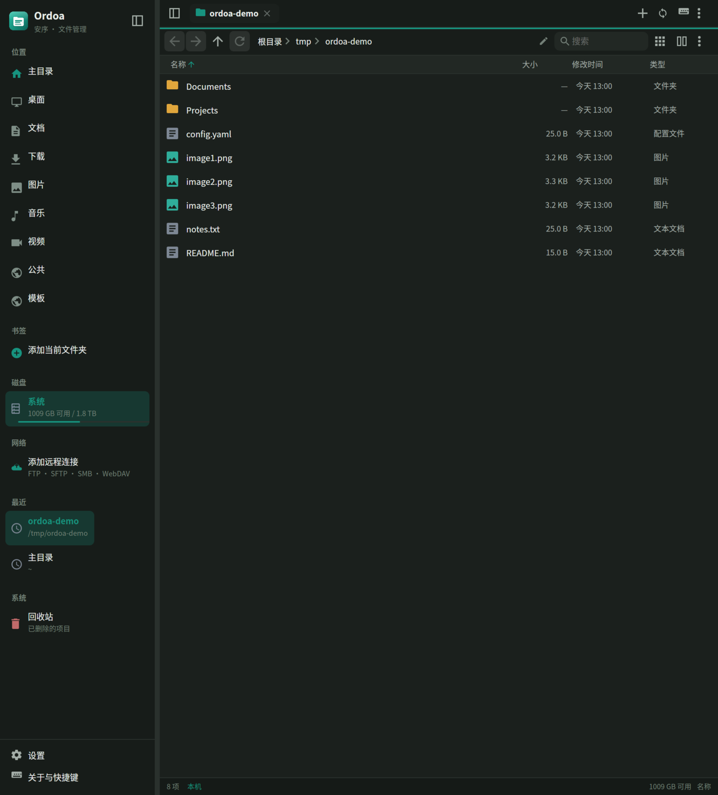
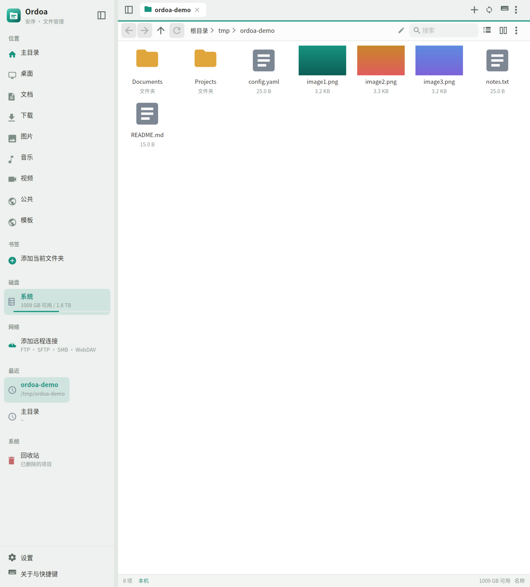
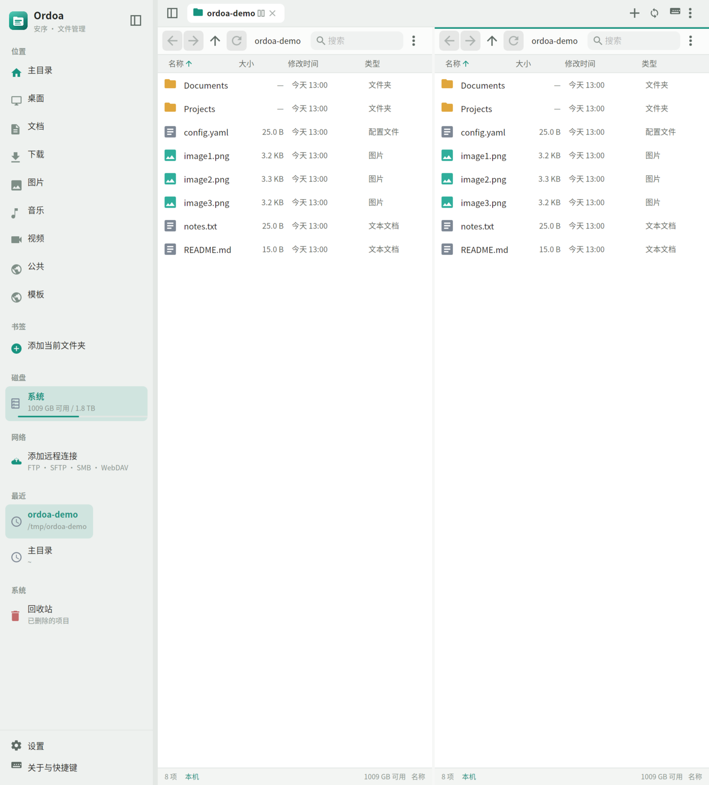
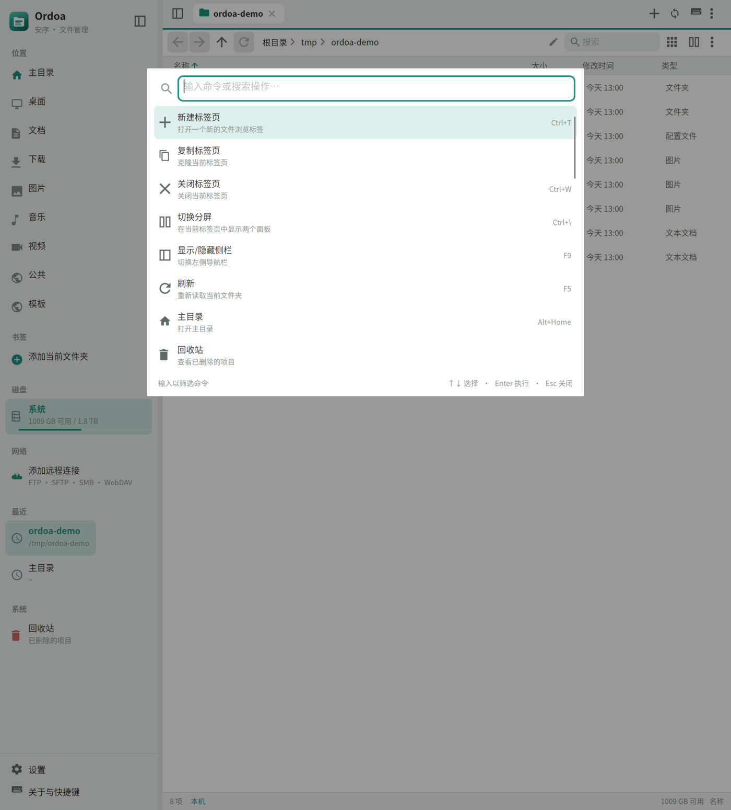
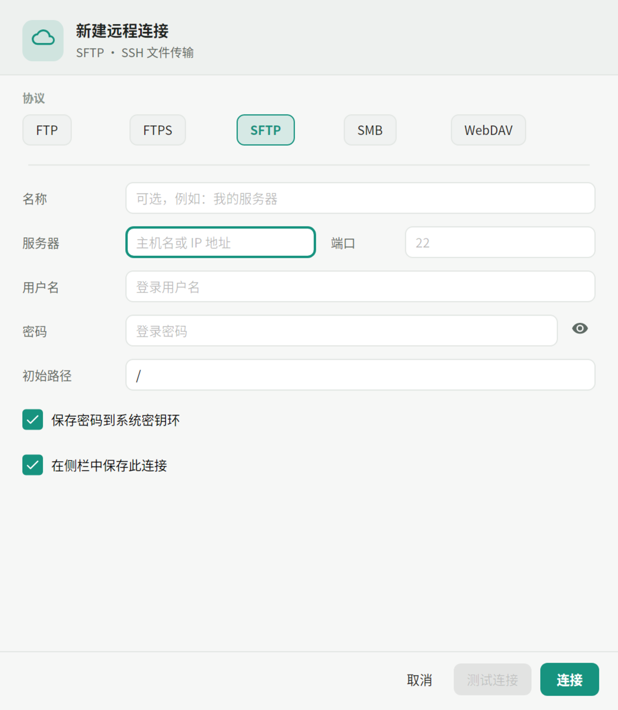
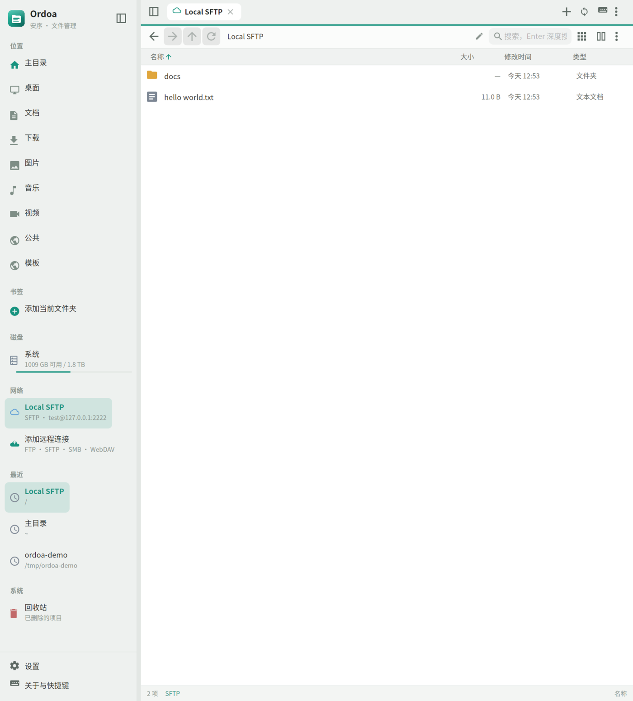

<p align="center">
  
</p>

<h1 align="center">Ordoa 安序</h1>

<p align="center">
  <b>Ordoa = Ordo（秩序）+ A（Avalonia）</b><br/>
  Linux 优先、克制而完整的文件管理器。多标签、分屏、本地与远程、键盘与命令面板。
</p>

<p align="center">
  
  
  
  
</p>

<p align="center">
  
  
</p>

## 设计目标

文件管理器不应该用一层层菜单淹没常用操作。Ordoa 把**导航、选择、打开**放在最显眼的位置，把复制、剪切、压缩、校验、权限、远程连接等能力收进右键菜单、更多菜单和命令面板。界面尽量安静，但在需要时不缺功能。

- **极简外观**：单行标签栏、面包屑、文件列表/网格、细状态栏。
- **高级能力**：跨文件系统传输队列、XDG 回收站、压缩/解压、SHA-256、chmod、远程会话与书签。
- **Linux 原生体验**：XDG 路径、XDG Trash、Unix 权限、系统密钥环（libsecret）、终端启动、磁盘挂载点。
- **键盘友好**：所有主要操作都有快捷键，`Ctrl+Shift+P` 可搜索并执行命令。
- **Avalonia 最新版**：Avalonia 12.1、C# 14、.NET 10；同时构建 macOS 与 Windows 版本。

## 功能

### 浏览与组织

- 多标签页：新建、复制、关闭、关闭其他、中键关闭、标签切换。
- 分屏：同一标签内双面板，可拖拽分隔条；窄面板自动精简工具栏。
- 列表 / 网格视图，网格支持本地图片缩略图。
- 面包屑导航、可编辑路径栏（`Ctrl+L`）、历史后退/前进/上一级。
- 自然排序（`file2` 在 `file10` 前），按名称 / 大小 / 修改时间 / 类型排序，文件夹优先。
- 隐藏文件切换、实时名称过滤、递归深度搜索（可在设置中限制深度与结果数）。
- 书签、最近访问、会话恢复（标签与分屏状态）；回收站固定在侧栏底部，始终可见。
- 设置中可逐项显示/隐藏侧栏「位置」中的常用目录，并可一键恢复默认。
- 文件系统监听：本地目录发生外部变化时自动刷新（防抖）。
- 内部拖放与跨应用拖放；可整体拖动多选项目，拖到文件夹可直接放入，拖到侧栏「回收站」或回收站面板即移到回收站；按住 `Shift` 拖到回收站则永久删除。
- 拖放修饰键：`Ctrl` 复制、`Shift` 移动；默认同一文件系统内移动，跨文件系统复制。
- 选择修饰键：`Ctrl+单击` 加选/取消，`Shift+单击` 连选；在空白处拖动可框选，按住 `Ctrl` / `Shift` 框选为追加。
- 系统剪贴板：复制/剪切本地文件会同时写入文件列表与文本路径，可与其他文件管理器互操作。

### 文件操作

- 复制、剪切、粘贴、移动、重命名、新建文件夹/空文件、永久删除。
- 操作队列：进度、速度、预计剩余时间、取消、错误汇总；跨文件系统流式复制。
- 传输面板仅在耗时操作时自动展开，小文件的快速移动/删除不会打断浏览。
- 冲突处理：替换、跳过、保留两者（自动改名）、对全部应用。
- 回收站：完整实现 freedesktop.org Trash 规范（home trash 与 `.Trash-$uid` / `.Trash/$uid`），支持恢复、永久删除、清空。
- 压缩：ZIP、tar、tar.gz；解压时校验路径，拒绝 zip-slip 与压缩包内链接。
- SHA-256 校验和，支持多文件批量计算与复制。
- 属性：类型、路径、大小、时间、MIME、Unix 权限（rwx 与八进制）、所有者/组（远程）、符号链接目标、回收站原始位置、文件夹内容统计。
- 本地 chmod 编辑（支持 SFTP 的 `chmod`）。
- 复制路径 / 名称、在终端中打开、调用系统默认应用打开文件。
- 远程文件可直接下载到缓存后交给系统应用打开。

### 远程文件系统

| 协议 | 实现 | 说明 |
| --- | --- | --- |
| FTP / FTPS | FluentFTP | 主动/被动、显式 FTPS；可选手动信任自签名证书 |
| SFTP | SSH.NET | 密码认证、主机密钥 TOFU（首次连接记录指纹） |
| SMB 2/3 | SMBLibrary | 列出共享、浏览、读写、重命名、删除；固定 TCP 445 |
| WebDAV | HttpClient | PROPFIND / GET / PUT / MKCOL / DELETE / MOVE / COPY，Basic 认证 |

- 连接管理器：保存连接、初始路径、密码保存策略；侧栏一键进入。
- 远程会话复用；地址栏支持 `sftp://`、`ftp://`、`ftps://`、`smb://`、`webdav://`、`https://` 等 URL。
- 远程↔本地、远程↔远程复制/移动通过统一的流式引擎完成。
- 连接测试（对话框内）与友好的错误提示。

### 界面与主题

- 浅色 / 深色 / 跟随系统；5 种强调色（翡翠、靛蓝、琥珀、玫瑰、紫罗兰）。
- 紧凑模式；侧栏宽度可调；窗口尺寸、侧栏状态、排序与视图持久化。
- 命令面板（`Ctrl+Shift+P`）覆盖所有主要操作。
- 传输面板、轻量 Toast、原生窗口装饰、无多余工具栏。
- 中文 / English 界面；设置中可切换语言或跟随系统（中文系统默认中文，其余默认英文）。
- 图标使用内嵌矢量路径，无图标字体依赖。

## 更多截图

| 网格视图 | 分屏 |
| --- | --- |
|  |  |

| 命令面板 | 连接设置 |
| --- | --- |
|  |  |

| 远程 SFTP |
| --- |
|  |

## 构建

### 依赖

- [.NET 10 SDK](https://dotnet.microsoft.com/)（C# 14）
- Linux：原生 Wayland（Avalonia 12.1 实验性后端，可用时优先启用）或 X11/XWayland；fontconfig；可选 `libsecret` / `secret-tool` 用于系统密钥环
- 构建不依赖系统原生文件管理器组件

### 命令

```bash
git clone <你的仓库地址> ordoa
cd ordoa

dotnet restore
dotnet build Ordoa.slnx
dotnet test tests/Ordoa.Core.Tests/Ordoa.Core.Tests.csproj

dotnet run --project src/Ordoa.App/Ordoa.App.csproj
```

打开指定目录或 URL：

```bash
dotnet run --project src/Ordoa.App/Ordoa.App.csproj -- /home/user/Downloads
dotnet run --project src/Ordoa.App/Ordoa.App.csproj -- sftp://user@example.com/
```

发布：

```bash
# 依赖系统 .NET 运行时
dotnet publish src/Ordoa.App/Ordoa.App.csproj -c Release -r linux-x64 --self-contained false

# 自包含
dotnet publish src/Ordoa.App/Ordoa.App.csproj -c Release -r linux-x64 --self-contained true
```

macOS 与 Windows 使用对应的 RID（`osx-arm64`、`osx-x64`、`win-x64`）即可构建。

## 安装（Linux）

```bash
chmod +x scripts/install.sh scripts/uninstall.sh
./scripts/install.sh
```

默认安装到 `~/.local`：程序、`ordoa` 命令、桌面菜单项与多尺寸图标。也可：

```bash
PREFIX=/usr/local sudo -E ./scripts/install.sh
./scripts/install.sh --self-contained
./scripts/uninstall.sh [--purge]
```

## 快捷键

| 快捷键 | 操作 |
| --- | --- |
| `Ctrl+T` / `Ctrl+W` | 新建标签页 / 关闭标签页（最后一个关闭窗口） |
| `Ctrl+Tab` / `Ctrl+Shift+Tab` | 下一个 / 上一个标签页 |
| `Alt+1…9` | 切换到第 1–9 个标签页 |
| `Ctrl+\` | 切换分屏 |
| `Ctrl+L` | 编辑地址 |
| `Ctrl+F` | 聚焦搜索；`Enter` 进行递归搜索 |
| `Ctrl+H` | 显示/隐藏隐藏文件 |
| `Ctrl+D` | 添加书签 |
| `Ctrl+1` / `Ctrl+2` | 列表 / 网格视图 |
| `Ctrl+Shift+P` | 命令面板 |
| `Ctrl+,` | 设置 |
| `Enter` / `Backspace` | 打开 / 上一级 |
| `Alt+←` / `Alt+→` / `Alt+↑` | 后退 / 前进 / 上一级 |
| `Alt+Home` | 主目录 |
| `Alt+Enter` | 属性 |
| `F1` | 关于与全部快捷键 |
| `F2` | 重命名 |
| `F5` | 刷新 |
| `F9` | 显示/隐藏侧栏 |
| `F11` | 全屏 |
| `Delete` / `Shift+Delete` | 移到回收站 / 永久删除 |
| `Ctrl+C` / `Ctrl+X` / `Ctrl+V` / `Ctrl+A` | 复制 / 剪切 / 粘贴 / 全选 |
| `Ctrl+Shift+N` | 新建文件夹 |

鼠标：双击打开；鼠标侧键（后退/前进）切换浏览历史；`Ctrl+单击` / `Shift+单击` 加选与连选；拖动多选项目可整体移动或复制；拖到侧栏「回收站」即移到回收站；`Ctrl`/`Shift` 可强制复制/移动。中键点击文件在标签页中打开其所在目录；中键点击标签关闭标签；右键打开完整上下文菜单。

## 配置与数据

遵循 XDG 路径（Linux）：

| 内容 | 路径 |
| --- | --- |
| 设置 | `~/.config/ordoa/settings.json` |
| 连接 | `~/.config/ordoa/connections.json` |
| 凭据回退文件（0600） | `~/.config/ordoa/credentials.json` |
| 书签 / 会话 / 最近 | `~/.config/ordoa/{bookmarks,session,recent}.json` |
| 缩略图 / 临时下载 | `~/.cache/ordoa` |
| 日志 | `~/.local/state/ordoa/ordoa.log` |
| 回收站 | `~/.local/share/Trash`（见 XDG Trash 规范） |

macOS 使用 `~/Library/Application Support/Ordoa` 与 `~/Library/Caches/Ordoa`；Windows 使用 `%APPDATA%\Ordoa` 与 `%LOCALAPPDATA%\Ordoa`。

### 凭据安全

- Linux 优先使用 `secret-tool`（Secret Service / libsecret）保存密码。
- macOS 优先使用 `security`（Keychain）。
- 不可用时回退到仅当前用户可读（0600）的 JSON 文件；这是有意的兼容路径，不是加密存储。
- SFTP 首次连接采用 TOFU：记录 SHA-256 主机密钥指纹，后续不匹配即拒绝连接。
- FTPS / WebDAV 默认校验证书；只有在连接设置中显式勾选后才接受自签名或无效证书。
- 明文 FTP 与 HTTP WebDAV 不提供传输加密，请优先使用 SFTP/FTPS/HTTPS。

## 架构

更详细的模块职责、线程模型与扩展协议步骤见 [docs/ARCHITECTURE.md](docs/ARCHITECTURE.md)。

```
src/Ordoa.Core
├── Abstractions/      IFileSystem、FileSystemBase
├── FileSystems/       LocalFileSystem、TrashFileSystem
│   └── Remote/        FTP、SFTP、SMB、WebDAV
├── Models/            FileEntry、连接配置、卷、能力
├── Services/          操作队列、搜索、压缩、回收站、凭据、连接、设置、会话
└── Util/              POSIX 路径、自然排序、格式化、XDG 路径

src/Ordoa.App
├── Views/             MainWindow、PaneView、对话框
├── ViewModels/        MainViewModel、Tab/Pane、对话框 VM
├── Services/          主题、剪贴板、缩略图、Shell、对话框、图标
├── Styles/            颜色、图标、控件样式
└── Assets/            应用图标

tests/Ordoa.Core.Tests
├── 路径/格式化/排序
├── 本地文件系统与操作引擎
├── 回收站（XDG 往返）
├── 压缩/解压
├── SHA-256
└── WebDAV（进程内 WebDAV 服务器端到端）
```

- **路径契约**：本地路径使用 OS 路径；远程文件系统使用 POSIX 路径。`IFileSystem` 暴露 `Combine / GetParent / NormalizePath / GetDisplayPath`，UI 不自行拼接远程路径。
- **操作引擎**：单后台队列，跨文件系统流式复制，递归目录、冲突策略、取消、进度节流；直接移动仅在同一个文件系统实例内尝试，失败自动回退为复制后删除。
- **UI 线程安全**：操作队列通过 Dispatcher 回传状态；面板加载强制在 UI 线程创建视觉相关对象。
- **Linux 专用能力**通过 `FileSystemCapabilities` 声明，UI 按能力启用/禁用命令，而不是按协议名硬编码。

## 已知限制

- 回收站目前只在 Linux 上完整实现。macOS/Windows 上删除会走永久删除并请求确认。
- SMB 使用 445 端口，暂不支持 SMB over QUIC、强制加密共享或 DFS 重定向。
- SFTP 暂只支持密码认证，尚未提供私钥/Agent 认证。
- WebDAV 目前只支持 Basic 认证；未实现 Digest、OAuth、分块上传。
- 网格视图使用 `WrapPanel`，超大目录（数万项）建议使用虚拟化的列表视图。
- 不提供内置预览器、媒体播放器或“打开方式”应用选择器；文件交给系统默认应用。
- 未实现单实例、D-Bus `org.freedesktop.FileManager1` 集成和系统级挂载。
- Linux 优先使用原生 Wayland 后端（Avalonia 12.1，实验性）；没有可用合成器时自动回退 X11/XWayland。可设置 `ORDOA_NO_WAYLAND=1` 强制使用 X11。Wayland 下 KDE 全局菜单、窗口图标、背景模糊等能力暂不可用。

## 路线图

- SSH 私钥 / Agent 认证与 known_hosts 集成
- SMB 加密共享、DFS 与端口配置
- 网格视图虚拟化
- 批量重命名、文件比较、预览面板
- Wayland 下的 CSD 细节与 KDE 全局菜单
- 单实例与 D-Bus 文件管理器接口

## 致谢

Ordoa 建立在许多优秀开源项目之上：

- [Avalonia](https://avaloniaui.net/) — 跨平台 UI 框架
- [CommunityToolkit.Mvvm](https://github.com/CommunityToolkit/dotnet) — MVVM 源生成器
- [FluentFTP](https://github.com/robinrodricks/FluentFTP) — FTP/FTPS
- [SSH.NET](https://github.com/sshnet/SSH.NET) — SFTP
- [SMBLibrary](https://github.com/TalAloni/SMBLibrary) — SMB 2/3
- [Material Design Icons](https://pictogrammers.com/library/mdi/) — 图标路径（Apache-2.0）
- [Inter](https://rsms.me/inter/) — 西文字体

## 许可

MIT License。详见 [LICENSE](LICENSE)。
