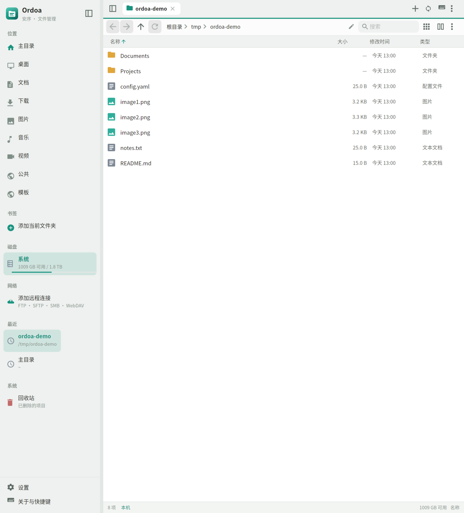
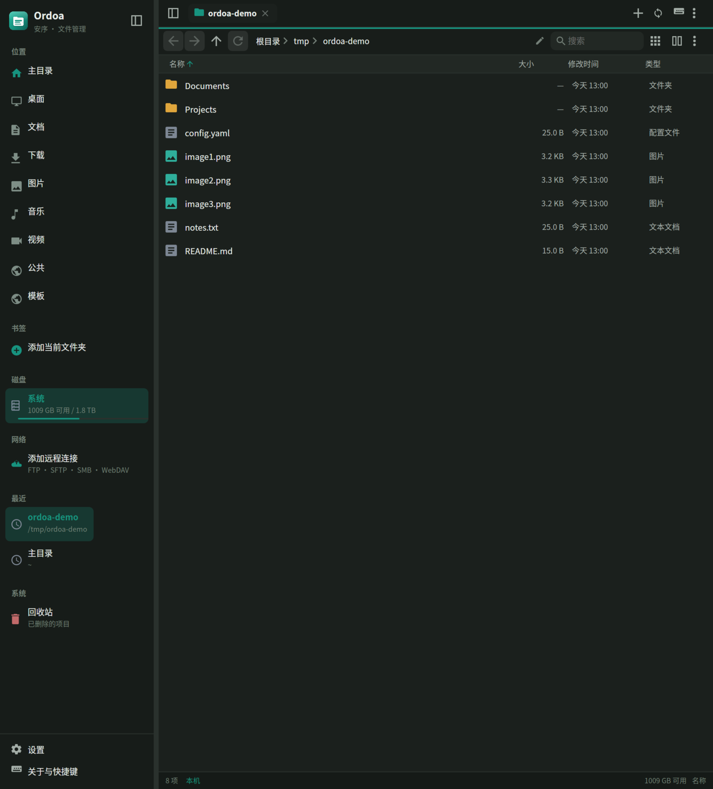
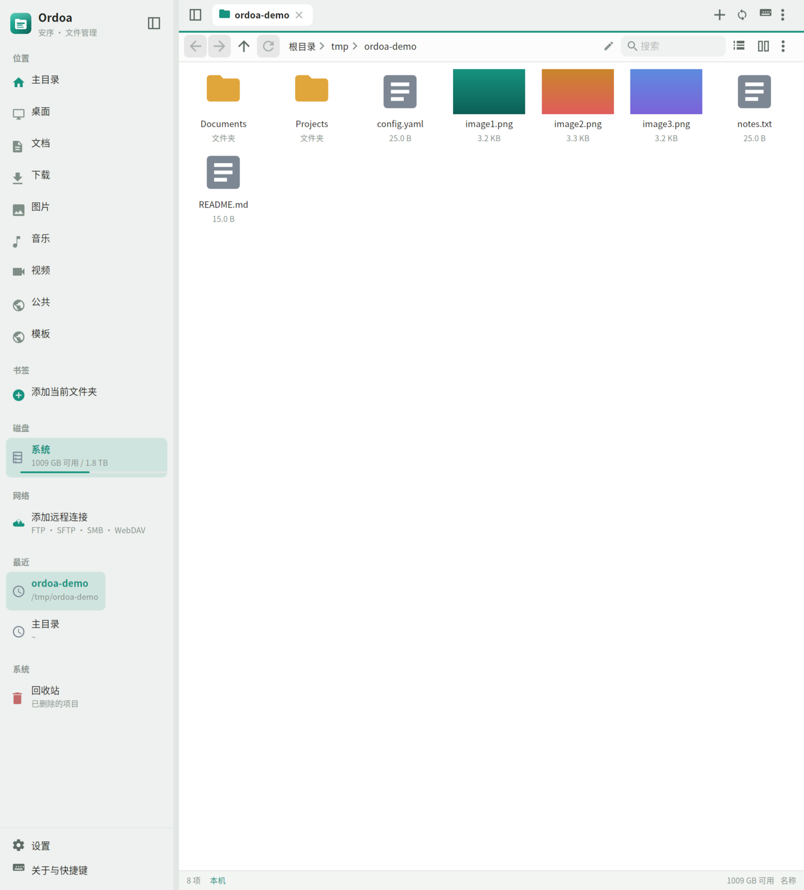
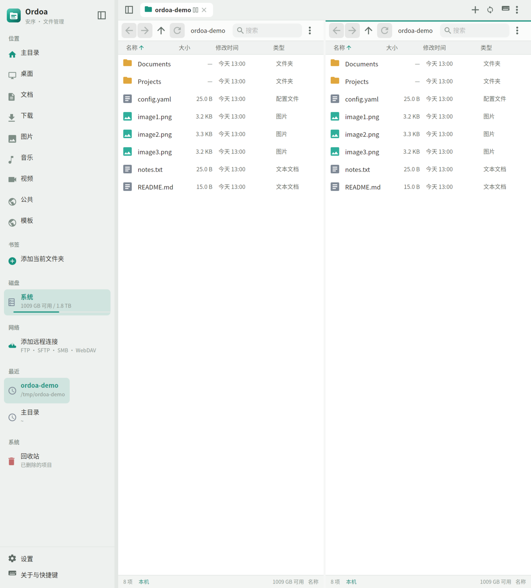
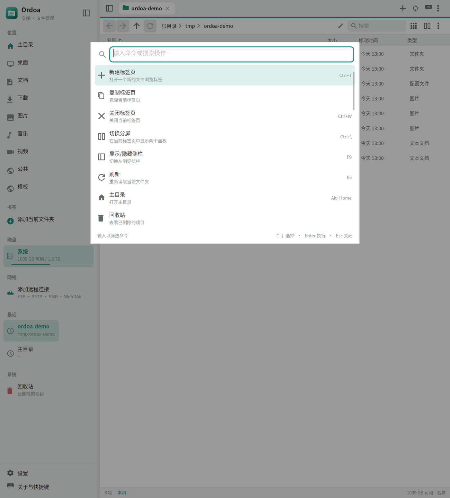
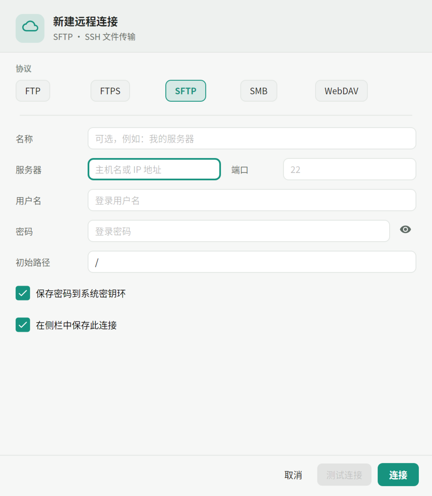
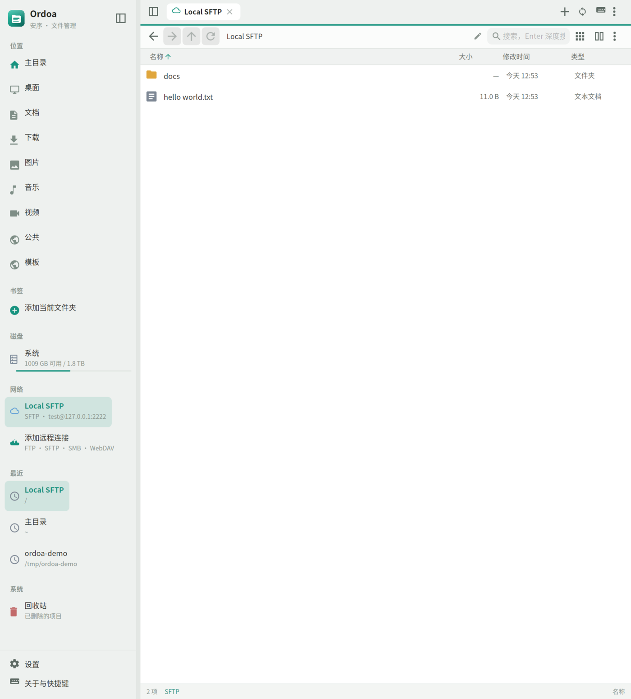

<p align="center">
  <a href="README.md">English</a> · <b>简体中文</b>
</p>

> Vibe Coding而成（DeepSeek V4.1 Flash / OpenCode）

<p align="center">
  
</p>

<h1 align="center">Ordoa</h1>

<p align="center">
  <b>Ordoa（安序）= Ordo（秩序）+ A（Avalonia）</b><br/>
  Linux 优先、克制而完整的文件管理器。多标签、分屏、本地与远程、键盘与命令面板。
</p>

<p align="center">
  
  
  
  
</p>

<p align="center">
  
  
</p>

## 设计目标

文件管理器不应该用一层层菜单淹没常用操作。Ordoa 把**导航、选择、打开**放在最显眼的位置，把复制、剪切、压缩、校验、权限、远程连接等能力收进右键菜单、更多菜单和命令面板。界面尽量安静，但在需要时不缺功能。

- **极简外观**：单行标签栏、面包屑、文件列表/网格、细状态栏；列表视图显示权限与所有者。
- **高级能力**：跨文件系统传输队列、XDG 回收站、压缩/解压、SHA-256、chmod、远程会话与书签；网格视图按可视区域虚拟化，超大目录也能快速滚动。
- **Linux 原生体验**：XDG 路径、XDG Trash、Unix 权限、系统密钥环（libsecret）、终端启动、磁盘挂载点。
- **键盘友好**：所有主要操作都有快捷键，`Ctrl+Shift+P` 可搜索并执行命令；常用操作的快捷键可在设置中重新绑定。
- **Avalonia 最新版**：Avalonia 12.1、C# 14、.NET 10；同时构建 macOS 与 Windows 版本。

## 功能

### 浏览与组织

- 多标签页：新建、复制、关闭、关闭其他、中键关闭、标签切换；可拖动排序、固定标签，`Ctrl+Shift+T` 恢复最近关闭的标签。
- 多窗口与单实例：`Ctrl+N` 新建窗口；再次启动默认复用当前进程。可在设置中选择外部文件夹请求在当前窗口还是新窗口打开，也可以关闭多窗口模式。
- 分屏：同一标签内双面板，可拖拽分隔条；窄面板自动精简工具栏。
- 列表 / 网格视图，网格支持本地图片、PDF 和视频缩略图；PDF/视频首帧使用可选的 poppler/ffmpeg，并按列表数量限流。
- 面包屑导航、可编辑路径栏（`Ctrl+L`）、历史后退/前进/上一级。
- 自然排序（`file2` 在 `file10` 前），按名称 / 大小 / 修改时间 / 类型 / 权限 / 所有者排序，文件夹优先。
- 列表 / 网格 / 树视图 / Miller 列视图：树视图在当前文件夹内按需展开子文件夹；Miller 列视图按列浏览多级目录，点击文件夹在右侧追加列，双击文件打开，保留 Git 标记与标签圆点。
- 列表列可配置：大小、修改时间、类型、权限、所有者和可选的标签/颜色列均可显示或隐藏；拖动列边界调整宽度、双击边界自适应、拖动表头左侧手柄调整顺序。列宽和顺序会全局与按文件夹分别记忆。
- 网格缩略图提供小/中/大三档，列表行高提供紧凑/标准/宽松三档。
- 列表视图可按类型、修改时间或大小分组，显示分组标题。
- 文件夹大小不随列表加载计算；右键「计算文件夹大小」可对选中文件夹按需递归统计。
- 隐藏文件切换、实时名称过滤、递归深度搜索（可在设置中限制深度与结果数）。
- 搜索语法：glob、`-排除词`、`ext:`、`type:`、`size:`、`modified:`、`content:`、`tag:`、`color:`；支持最近搜索、命名保存搜索、当前文件夹 / 整盘范围切换，搜索结果同样显示 Git 状态。
- 可选本地搜索索引（默认关闭）：白名单模式只索引列出的目录，黑名单模式在相同目录基础上应用排除规则；支持文件监听增量更新、定期或手动重建；内容、标签、颜色和远程查询会自动回退到扫描式搜索。
- 书签、最近访问、会话恢复（标签与分屏状态）；回收站固定在侧栏底部，始终可见。
- 设置中可逐项显示/隐藏侧栏「位置」中的常用目录，并可一键恢复默认。
- 磁盘列表在 macOS 上默认只显示系统盘与 `/Volumes` 下的用户卷；可在设置中关闭磁盘、显示系统隐藏卷，或添加任意自定义路径。
- 侧栏「磁盘」中的每一项都可以在设置中单独显示或隐藏；保存后立即刷新，全部隐藏时自动省略磁盘分区。
- macOS 上可将 `.app` 目录识别为应用程序：显示应用图标与类型，双击直接启动，右键「显示包内容」可进入 bundle；可在设置中关闭，Linux / Windows 默认不启用。
- Linux 磁盘可挂载、卸载和弹出（优先使用 udisksctl）；未挂载的可移动设备也会出现在侧栏。GVfs 挂载（MTP 相机/手机、SMB、SFTP 等）会自动显示为磁盘。
- 文件系统监听：本地目录发生外部变化时自动刷新（防抖）。
- 内部拖放与跨应用拖放；可整体拖动多选项目，拖到文件夹可直接放入，拖到侧栏「回收站」或回收站面板即移到回收站；按住 `Shift` 拖到回收站则永久删除。
- 拖放修饰键：`Ctrl` 复制、`Shift` 移动；默认同一文件系统内移动，跨文件系统复制。
- 选择修饰键：`Ctrl+单击` 加选/取消，`Shift+单击` 连选；在空白处拖动可框选，按住 `Ctrl` / `Shift` 框选为追加。
- 系统剪贴板：复制/剪切本地文件会同时写入文件列表与文本路径，可与其他文件管理器互操作。
- 打开方式：Linux 下可从已安装应用中选择，并记住某个扩展名的默认应用；其他平台回退到系统默认应用。
- 系统文件管理器集成：Linux 下可注册为默认文件管理器，并提供 `org.freedesktop.FileManager1` D-Bus 接口，供浏览器、IDE 等“在文件夹中显示”调用；macOS 与 Windows 提供“在 Finder / 资源管理器中显示”。
- 可选系统菜单集成，默认关闭：Windows 资源管理器「Open in Ordoa」「在此处打开 Ordoa」，以及 macOS「在 Ordoa 中打开」Finder 快速操作。只写入当前用户的注册表或 `~/Library/Services`。
- 深色模式提供石墨、午夜蓝、冷灰、深海、森林、暖棕、纯黑七套配色，统一应用到窗口、侧栏、列表、菜单和对话框。

### 搜索与过滤

- 输入即实时过滤当前文件夹，且同样支持名称、glob、排除、ext/type/size/modified/tag/color 语法（content 需按 Enter 递归搜索）；按 `Enter` 递归搜索，搜索框右侧按钮可查看语法、历史和保存的搜索。
- 名称匹配支持 `*`、`?` glob；多个词需要同时匹配，`-词` 排除匹配项并跳过同名文件夹（例如 `-node_modules`）。
- `ext:cs,json` 按扩展名过滤；`type:file|folder|image|video|audio|text|document|archive|code|config` 按类别过滤。
- `size:>10MB`、`size:1KB..2MB` 按大小过滤；`modified:>7d`、`modified:today`、`modified:2024-01-01..2025-01-01` 按修改时间过滤。
- `content:TODO` 或 `content:"hello world"` 搜索文件内容（grep 风格，跳过二进制文件和超过 8MB 的文件）。
- `tag:work`、`tag:work,urgent` 和 `color:red` 可按文件标签与颜色过滤搜索结果。
- 搜索范围可在「当前文件夹」和「整个磁盘 / 整个连接」之间切换；搜索完成后在后台为结果补充 Git 状态。
- 最近 20 条搜索自动保存；命名搜索可长期保留，并可从搜索面板一键删除。

### 快速预览

- 选中文件后按 `Space` 打开快速预览，再按 `Space` / `Esc` 关闭，`Enter` 直接打开文件；右键菜单和命令面板也可进入。
- 常驻预览面板：按 `F3` 或点击工具栏眼睛图标显示/隐藏，默认关闭；可在设置中选择停靠在右侧或底部，选中文件时自动刷新。
- 文本、源码、配置、CSV、SVG 等按文本读取，限制读取大小，自动识别 UTF-8 / UTF-16 / UTF-32 / GB18030，并提供文件名、编码、行数等信息。
- 图片使用 Avalonia / Skia 原生解码，并用纯托管 [SimdCodecs](https://www.nuget.org/packages/Sdcb.SimdCodecs) 补充 TIFF、JPEG 2000、QOI、Netpbm 等格式；支持 EXIF 方向、缩放与动图首帧。
- 视频显示首帧缩略图与时长、分辨率、编码、码率、音轨等信息；音频显示容器、时长、编码、采样率与声道。二者通过可选的 ffmpeg / ffprobe 完成，软件不附带它们。
- ZIP / JAR / tar / tar.gz 直接列出前 200 个条目；文件夹预览列出内容。
- Markdown 预览用原生 Avalonia 控件渲染标题、段落、列表、引用、代码块、表格、链接和行内强调；Markdig 只作为 .NET 解析器，不引入 WebView。
- 代码与配置文件提供轻量语法高亮和行号；CSV/TSV 以有界表格显示。
- PDF 在系统安装 poppler-utils（`pdftoppm`/`pdfinfo`）时支持多页、上一页/下一页和缩放；Office/ODF/EPUB 会尝试读取文档内嵌缩略图。
- 其他二进制文件显示类型、大小、时间和文件头十六进制；未知格式不会静默失败。
- 不引入 WebView、浏览器内核或原生图像处理依赖。

### Git 版本状态

- 打开 Git 仓库内的文件夹时，状态栏显示当前分支、领先/落后提交数以及未提交变更数量。
- 列表和网格视图会在文件、文件夹旁显示 Git 标记：已修改、已暂存、未跟踪、冲突等；已提交且无变更的文件和文件夹显示绿色勾；被 Git 忽略的文件使用单独的淡化样式并显示灰色 `I`，不会与隐藏文件的淡化混淆。
- 在仓库外部浏览父文件夹时，仓库文件夹本身显示 `GIT` 标记；子模块显示 `S` 特殊标记。
- 「Git 状态」窗口列出全部未提交项目、暂存状态、分支与上游信息，可双击定位到对应文件。
- 设置中的「Git」分类可以关闭 Git 集成，或分别控制状态栏、文件标记、绿色勾、仓库标记、子模块标记和忽略文件淡显。
- 仅读取 `git status` 与 `git ls-files`，不会暂存、提交或修改仓库；需要系统 PATH 中可用的 `git` 命令。

### 磁盘分析

- 磁盘占用分析：以可点击的树图显示文件夹的递归占用，支持逐级进入、返回上一级、重新扫描；右侧同时列出当前目录项目和全盘最大文件。
- 重复文件查找：先按文件大小分组，再对候选文件做首尾快速指纹，最后用 SHA-256 校验内容；支持最小文件大小、分组选择、全选重复项和移到回收站。
- 两项分析都在后台扫描，支持进度显示和取消，并可从文件区右键「分析工具」、侧栏右键或命令面板启动。
- 文件比较：选中两个文件后并排查看文本差异（行级 LCS，超大文件退化为逐行对比）或二进制差异（大小、SHA-256、首个差异偏移）。
- 文件夹比较与同步：递归比较两个文件夹，显示仅左侧/仅右侧/较新/不同/类型不同，可按 SHA-256 比较内容，支持仅显示差异、试运行，并通过传输队列执行单行或批量复制。
- 标签与颜色：右键「标签与颜色」可为文件或文件夹设置颜色和多个标签，列表与网格显示颜色圆点，悬停可查看标签；标签数据保存在独立的 `tags.json` 中，本地、远程和压缩包路径都可用。
- 图片批量转换：选中多张图片后选择 JPEG / PNG / WebP、质量、最大边长、输出目录和文件名后缀；默认添加 `-converted` 避免覆盖原图。

### 文件操作

- 复制、剪切、粘贴、移动、重命名、新建文件夹/空文件、永久删除。
- 复制到… / 移动到… 目标选择、原地创建副本、将剪贴板项目粘贴为符号链接。
- 压缩包浏览：双击 zip、tar、tar.gz、tgz、7z 或 rar 即可像文件夹一样逐层浏览；文件按需解压到缓存，可复制到本地或按空格预览。7z/rar 需要系统安装 `7z` 命令行工具；加密压缩包打开时会提示输入密码。
- 压缩包内搜索：搜索框和 `content:` 语法对压缩包同样生效，支持在当前压缩包路径中递归查找。
- 解压选中项到任意文件夹：在压缩包内选中文件或文件夹后右键「解压到…」；普通目录中也可对选中的压缩包使用同一命令。
- 压缩包内写入：在 zip、tar、tar.gz、7z 中可添加文件、重命名和删除项目；rar 只读。zip 在缺少 7z 时使用内置更新，其他格式需要系统 7z。
- 撤销 / 重做：会话级历史，覆盖重命名、移动、移到回收站、新建和复制；一次批量操作合并为一条记录。撤销前检查目标是否被占用或修改，冲突时提示而不会强行覆盖。
- 链接：右键可创建符号链接、相对符号链接或硬链接；硬链接仅适用于文件。
- 属性窗口可查看扩展属性和 POSIX ACL，并使用 `chown` 修改所有者和用户组；Linux 下可直接编辑扩展属性和 ACL 文本，macOS 通过 `xattr` 读取；后者通常需要管理员权限。
- 可选管理员操作：Linux 使用 pkexec、macOS 使用 osascript、Windows 使用 UAC 执行删除、复制和移动；默认关闭，每次都会要求系统确认。
- 本地复制会尽力保留扩展属性；权限和修改时间沿用原有处理。
- 撤销范围可设置为跟随系统、完整（包括复制）、仅结构操作或关闭；Windows / macOS 默认完整撤销，Linux 默认只撤销重命名、移动、回收站和新建。
- 批量重命名：查找替换、正则捕获组（`$1`、`${name}`）、序号、大小写、扩展名与日期变量；实时预览并检测非法名称、重名和已有文件冲突，支持本地与远程文件系统。
- 批量权限/所有者：在一个对话框中为多选项目设置八进制权限和所有者/用户组；所有权修改仅限本地文件，通常需要管理员权限。
- 批量复制/移动前，如果检测到同名项目，会先显示目标路径和冲突清单，可统一选择替换、跳过或保留两者；超过 500 个项目时只预览前 500 个，其余在执行时询问。
- 操作队列：进度、速度、预计剩余时间、取消、错误汇总；跨文件系统流式复制。
- 传输面板仅在耗时操作时自动展开，小文件的快速移动/删除不会打断浏览；传输支持暂停、继续、取消。
- 失败重试针对具体文件：失败项会保存在传输面板中，可展开查看并只重试失败的文件，而不是整批重来。
- 复制完成后默认校验目标文件大小，也可在设置中改用 SHA-256 或关闭校验；校验失败的文件会单独标记并允许重试。
- 设置中可限制传输速度（MB/s）和同时执行的传输任务数（1–4）；速度限制对所有传输任务共享生效。
- 传输日志：未完成的复制/移动请求会持久化，并在重启后重新加入队列。恢复时会重新复制受影响的文件，不会按字节偏移续写已部分写入的文件。
- 操作历史窗口记录本次会话的复制、移动、删除、回收站和恢复操作，包含成功/失败数量与错误详情。
- 撤销历史面板显示可撤销与可重做的步骤及时间，并可直接执行撤销或重做。
- 冲突处理：替换、跳过、保留两者（自动改名）、对全部应用。
- 回收站：Linux 完整实现 freedesktop.org Trash 规范（home trash 与 `.Trash-$uid` / `.Trash/$uid`），支持恢复、永久删除、清空；macOS 使用 `~/.Trash` 并保留恢复信息；Windows 使用系统回收站。
- 压缩：ZIP、tar、tar.gz、tar.zst、tar.xz、7z；7z 支持压缩级别、分卷大小和可选密码/头部加密；zstd/xz 使用可选的系统命令行工具。解压时校验路径，拒绝 zip-slip 与压缩包内链接。
- 旧 ZIP 文件名编码会自动尝试 UTF-8、GBK、Shift-JIS、CP437，并可在设置中手动覆盖。
- 支持从 `~/.ssh/config` 导入具体 Host 别名、HostName、User、Port、IdentityFile 和 ProxyJump；支持 Include glob 和简单 Match 块。复杂的 exec/localnetwork 条件会被有意忽略。
- 密码优先保存到系统密钥环：Linux libsecret、macOS Keychain、Windows Credential Manager；0600 JSON 文件仅作为回退。
- 校验和：MD5、SHA-1、SHA-256、SHA-512，支持多文件批量计算与复制；可对照 GNU/BSD 校验文件，并可在不关闭对话框的情况下切换算法。
- 属性：类型、路径、大小、时间、MIME、Unix 权限（rwx 与八进制）、所有者/组（本地与远程）、符号链接目标、回收站原始位置、文件夹内容统计。
- 本地 chmod 编辑（支持 SFTP 的 `chmod`）。
- 复制路径 / 名称、在终端中打开、调用系统默认应用打开文件。
- 远程文件可直接下载到缓存后交给系统应用打开；在外部应用中保存后会自动回传修改（可在设置中关闭）。
- 远程状态栏显示最近一次列目录耗时（绿色 ≤300ms、黄色 ≤1s、红色更慢），失败时显示「离线」。
- 远程目录读取失败时会自动尝试重建会话并重试一次；多个面板共享同一连接时会复用最新会话，避免重复断线。
- 远程网格视图可加载图片缩略图（远程图片上限 24MB，本地 200MB）。
- 远程视频、音频、PDF、Office 和压缩包预览会按需下载到缓存后交给内置预览器或 ffmpeg / pdftoppm，下载上限分别为 512MB（媒体）、128MB（PDF/Office）和 256MB（压缩包）。

### 终端与自定义命令

- 终端扫描：自动探测常见的 Linux、macOS 与 Windows 终端，选择哪个是默认终端、哪些出现在右键菜单；macOS 下同时检查 PATH、Homebrew / MacPorts 路径以及 `/Applications`、`~/Applications` 等位置，支持 Terminal、iTerm2、Ghostty、WezTerm、Kitty、Alacritty、Rio、Warp、Tabby、Hyper、MacTerm 等。也可切换到手动路径模式，自行指定可执行文件和参数。
- 在终端中打开：文件区、侧栏和命令面板均可使用；右键菜单可通过“使用其他终端打开”选择已启用的终端。
- Herdr：检测到 `herdr` 时提供独立的“在 Herdr 中打开”，默认关闭，可在设置里启用；它会在当前终端中创建或附加 Herdr 工作区。
- 自定义命令：用 `%f`、`%F`、`%n`、`%N`、`%d`、`%p`、`%%` 等占位符运行脚本；可设置工作目录、是否显示在右键菜单、是否在终端中运行、是否要求有选中项、运行前确认、把选中路径写入标准输入、附加环境变量，以及是否固定到工具栏。命令同时会加入命令面板。
- 命令面板：按使用频率和最近使用排序；执行记录保存在设置中。
- 工作区：在命令面板中保存当前标签页与分屏布局，之后可恢复为命名工作区；工作区列表保存在独立文件中。
- 跨窗口拖动标签：把标签拖出当前窗口并放到另一个 Ordoa 窗口的标签栏即可移动标签；源窗口最后一个标签移走后会自动关闭。
- 最近关闭窗口：关闭一个窗口后，可从命令面板「重新打开关闭的窗口」恢复其中的标签页和分屏。
- 快捷键冲突检测：设置中的快捷键列表会实时提示重复组合。

### 远程文件系统

| 协议 | 实现 | 说明 |
| --- | --- | --- |
| FTP / FTPS | FluentFTP | 主动/被动、显式 FTPS；可选手动信任自签名证书 |
| SFTP | SSH.NET | 密码、私钥（含口令）、SSH Agent 认证；known_hosts 校验与 TOFU |
| SMB 2/3 | SMBLibrary | 列出共享、浏览、读写、重命名、删除；固定 TCP 445 |
| WebDAV | HttpClient | PROPFIND / GET / PUT / MKCOL / DELETE / MOVE / COPY，Basic 认证 |
| S3 / 兼容对象存储 | 内置 SigV4 客户端 | AWS S3、MinIO、Cloudflare R2、B2 兼容端点；路径风格或虚拟主机 URL；列出、读取、上传、复制、移动、删除 |

- 连接管理器：保存连接、初始路径、密码/私钥口令保存策略；支持密码、私钥和 SSH Agent 认证。连接失败会保留为可编辑的失败项；设置中可隐藏、复制或删除已保存的连接。
- 远程会话复用；地址栏支持 `sftp://`、`ftp://`、`ftps://`、`smb://`、`webdav://`、`https://`、`s3://` 等 URL。
- 导入 `~/.ssh/config` 时展开 `Include` glob，应用 host/originalhost/user `Match` 块，并读取 HostName、User、Port、IdentityFile 和 ProxyJump。
- SFTP ProxyJump 支持单级和多级 SSH 端口转发；跳板机同样会校验 known_hosts，每一跳都可以单独设置用户名、端口、密码、私钥或 SSH Agent。
- 局域网发现使用原生 mDNS 查询和 WS-Discovery，可直接填入 SFTP、SMB、FTP 和 WebDAV 主机。
- 远程↔本地、远程↔远程复制/移动通过统一的流式引擎完成。
- 连接测试（对话框内）与友好的错误提示。

### 界面与主题

- 浅色 / 深色 / 跟随系统 / 高对比度；5 种强调色（翡翠、靛蓝、琥珀、玫瑰、紫罗兰）。
- 7 套深色中性背景：石墨、午夜蓝、冷灰、深海、森林、暖棕、纯黑。
- 紧凑模式；侧栏宽度可调；窗口尺寸、侧栏状态、排序与视图持久化。
- 命令面板（`Ctrl+Shift+P`）覆盖所有主要操作。
- 传输面板、轻量 Toast、默认沉浸式自绘标题栏；niri、Sway、Hyprland 等平铺合成器会自动隐藏自绘窗口按钮，可在设置中强制显示或恢复系统标题栏。
- 中文 / English / 日本語 / 한국어 / Deutsch / Français / Español 界面；设置中可切换或跟随系统，未翻译条目回退到英文。
- 键盘焦点环，文件列表、搜索、路径、预览和连接字段提供无障碍名称与屏幕阅读器元数据。
- 说明性提示默认折叠为信息图标，悬停查看完整内容；可在设置 → 外观中关闭折叠，恢复为完整文字。
- 关于窗口显示与 git tag 对齐的两位版本号、6 位提交号，以及 AOT / 运行时信息。
- 图标使用内嵌矢量路径，无图标字体依赖。

## 更多截图

| 网格视图 | 分屏 |
| --- | --- |
|  |  |

| 命令面板 | 连接设置 |
| --- | --- |
|  |  |

| 远程 SFTP |
| --- |
|  |

## 构建

### 依赖

- [.NET 10 SDK](https://dotnet.microsoft.com/)（C# 14）
- Linux：原生 Wayland（Avalonia 12.1 实验性后端，可用时优先启用）或 X11/XWayland；fontconfig；可选 `libsecret` / `secret-tool` 用于系统密钥环
- 构建不依赖系统原生文件管理器组件
- 快速预览可选：视频/音频信息与缩略图需要 `ffmpeg` / `ffprobe`（可通过设置或 `ORDOA_FFMPEG` / `FFMPEG_PATH` 指定）；PDF 首页需要 `pdftoppm`（poppler-utils）

### 命令

```bash
git clone <你的仓库地址> ordoa
cd ordoa

dotnet restore
dotnet build Ordoa.slnx
dotnet test tests/Ordoa.Core.Tests/Ordoa.Core.Tests.csproj

dotnet run --project src/Ordoa.App/Ordoa.App.csproj
```

打开指定目录或 URL：

```bash
dotnet run --project src/Ordoa.App/Ordoa.App.csproj -- /home/user/Downloads
dotnet run --project src/Ordoa.App/Ordoa.App.csproj -- sftp://user@example.com/
```

Linux 集成相关参数：

```bash
ordoa --new-window /path/to/folder   # 强制新窗口
ordoa --new-tab /path/to/folder      # 强制当前窗口新标签
ordoa --register-file-manager        # 注册桌面项、D-Bus 服务和默认文件管理器
ordoa --no-single-instance           # 本次启动不使用单实例
ordoa --undo                         # 让运行中的实例撤销上一步
ordoa --redo                         # 让运行中的实例重做上一步
```

### 发布脚本

类 Unix 使用 `scripts/publish.sh`：

```bash
# 托管发布：多文件，目标机需要 .NET 10 Desktop Runtime
./scripts/publish.sh framework

# 托管单文件：目标机需要 .NET 10 Desktop Runtime
./scripts/publish.sh single --rid linux-arm64

# NativeAOT：自包含，不需要 .NET 运行时
./scripts/publish.sh aot

# NativeAOT 静态单文件：SkiaSharp / HarfBuzz / ANGLE 静态链接
./scripts/publish.sh aot-static
```

Windows 提供批处理和 PowerShell 两套入口（需要 Windows PowerShell 5.1 或 PowerShell 7；`publish.bat` 会自动选择可用的那个）：

```bat
scripts\publish.bat framework
scripts\publish.bat single -Rid win-x64
scripts\publish.bat aot
scripts\publish.bat aot-static
```

也可以直接运行 PowerShell：

```powershell
.\scripts\publish.ps1 aot -Rid win-x64 -Configuration Release
```

四种模式：

| 模式 | 运行时 | 输出 |
| --- | --- | --- |
| `framework` | 依赖 .NET 10 Desktop Runtime | 多文件；默认自动检测当前 RID，加 `--portable` 可输出可移植版本 |
| `single` | 依赖 .NET 10 Desktop Runtime | 单文件；原生库首次启动时自解压 |
| `aot` | 不依赖 .NET | NativeAOT 原生程序，仍需携带 SkiaSharp / HarfBuzz 原生库 |
| `aot-static` | 不依赖 .NET | 单文件；通过 `StaticLink.Avalonia` 静态链接 SkiaSharp / HarfBuzz / ANGLE，仍依赖系统 fontconfig / freetype / zlib 等库 |

默认输出到项目根目录下的 `artifacts/publish/<模式>/<RID|portable>`。该目录已在 `.gitignore` 中忽略，只保留 `artifacts/README.md` 作为说明。省略 `RID` 时会自动检测当前平台；framework 模式可用 `--portable` 生成不绑定 RID 的版本（会包含多个平台的原生资源，目录更大）。常用选项：

```bash
./scripts/publish.sh framework --rid linux-x64 --configuration Release
./scripts/publish.sh framework --portable
./scripts/publish.sh single --output /tmp/ordoa-single --no-clean
./scripts/publish.sh aot --no-restore
./scripts/publish.sh aot-static --rid linux-x64
```

NativeAOT 需要本机 C/C++ 工具链：Linux 上为 clang 或 gcc，Windows 上为 Visual Studio C++ 生成工具与 Windows SDK。

`aot-static` 还需要：

- `lld`（Linux）
- `StaticLink.Avalonia` 对应的系统开发库：fontconfig、freetype、zlib、libx11、libxext、libxcb、wayland、libffi 等
- 首次还原会下载较大的静态库包（约 115 MB，解压约 533 MB）

`aot-static` 输出为单文件；`aot` 输出不是单文件，`libSkiaSharp.so` / `libHarfBuzzSharp.so`（Windows 为对应 DLL）需要与可执行文件放在同一目录。

`aot-static` 使用的是第三方 MIT 包 [StaticLink.Avalonia](https://github.com/greepar/StaticLink.Avalonia)，版本与 Avalonia 12.1.4 / SkiaSharp 3.119.4 / HarfBuzzSharp 8.3.1.3 对齐。它不是完全静态可执行文件，运行时仍依赖 glibc、fontconfig、freetype 等系统库。

macOS 使用 `aot-static` 时还需要 `StaticLink.Avalonia.Native`（脚本/项目已按 macOS RID 条件引用），并要求 macOS 13 或更高。

### GitHub Actions 自动发布

推送 `v*` 标签会自动触发 `.github/workflows/release.yml`：

```bash
git tag v0.3
git push origin v0.3
```

发布会生成：

- Windows x64 框架依赖 zip
- Windows x64 AOT zip
- Windows x64 AOT 静态单文件 zip
- macOS arm64 框架依赖 zip
- macOS arm64 AOT DMG
- Linux x64 框架依赖 tar.gz
- Linux x64 AOT deb
- Linux x64 AOT AppImage
- Linux x64 AOT 静态单文件 tar.gz

macOS DMG **未做代码签名，也未做公证**：项目没有 Apple Developer ID 证书，CI 无法提交 Apple 公证服务，因此 Gatekeeper 可能阻止首次启动。确认下载来源后，可在 Finder 中右键应用选择“打开”，或执行 `xattr -dr com.apple.quarantine /Applications/Ordoa.app` 移除隔离属性。

AOT 发布现在只会出现 `SMBLibrary` 的 `IL2104` 提示。Avalonia 已启用编译绑定（所有 Window/UserControl 与 DataTemplate 都声明了 `x:DataType`），本地化 `{loc:Tr}` 扩展也已改为编译绑定路径；同时通过 `TrimmerRootAssembly` 保留应用程序集，release 输出会自动移除 `*.pdb`。

macOS 与 Windows 使用对应的 RID（`osx-arm64`、`osx-x64`、`win-x64`）即可构建。

## 安装（Linux）

```bash
chmod +x scripts/install.sh scripts/uninstall.sh
./scripts/install.sh
```

默认安装到 `~/.local`：程序、`ordoa` 命令、桌面菜单项与多尺寸图标。也可：

```bash
PREFIX=/usr/local sudo -E ./scripts/install.sh
./scripts/install.sh --self-contained
./scripts/uninstall.sh [--purge]
```

### Arch Linux / Arch Linux ARM

```bash
chmod +x scripts/install-arch.sh scripts/uninstall-arch.sh
./scripts/install-arch.sh
./scripts/uninstall-arch.sh [--purge] [--yes]
```

`install-arch.sh` 会用 NativeAOT 发布，生成 `.pkg.tar.zst`，再通过 `pacman -U` 安装到系统。需要 `pacman`、`makepkg`、`fakeroot`、`sudo` 和 .NET 10 SDK；缺少 `clang` 时会尝试用 pacman 安装。

支持：

```bash
./scripts/install-arch.sh --yes          # 不询问确认
./scripts/install-arch.sh --build-only   # 只生成 pacman 包
./scripts/install-arch.sh --rid linux-arm64
```

## 快捷键

| 快捷键 | 操作 |
| --- | --- |
| `Ctrl+T` / `Ctrl+W` | 新建标签页 / 关闭标签页（最后一个关闭窗口） |
| `Ctrl+Shift+T` | 恢复最近关闭的标签页 |
| `Ctrl+Tab` / `Ctrl+Shift+Tab` | 下一个 / 上一个标签页 |
| `Alt+1…9` | 切换到第 1–9 个标签页 |
| `Ctrl+\` | 切换分屏 |
| `Ctrl+L` | 编辑地址 |
| `Ctrl+F` | 聚焦搜索；`Enter` 进行递归搜索 |
| `Ctrl+H` | 显示/隐藏隐藏文件 |
| `Ctrl+D` | 添加书签 |
| `Ctrl+1` / `Ctrl+2` | 列表 / 网格视图 |
| `Ctrl+Shift+P` | 命令面板 |
| `Ctrl+,` | 设置 |
| `Space` | 快速预览选中的文件 / 关闭预览 |
| `F3` | 显示 / 隐藏常驻预览面板 |
| `Enter` / `Esc` | 预览中打开文件 / 关闭预览 |
| `Enter` / `Backspace` | 打开 / 上一级 |
| `Alt+←` / `Alt+→` / `Alt+↑` | 后退 / 前进 / 上一级 |
| `Alt+Home` | 主目录 |
| `Alt+Enter` | 属性 |
| `F1` | 关于与全部快捷键 |
| `F2` | 重命名 |
| `Ctrl+Shift+R` | 批量重命名 |
| `Ctrl+Shift+O` | 打开方式 |
| `Ctrl+N` | 新建窗口 |
| `F5` | 刷新 |
| `F9` | 显示/隐藏侧栏 |
| `F11` | 全屏 |
| `Delete` / `Shift+Delete` | 移到回收站 / 永久删除 |
| `Ctrl+C` / `Ctrl+X` / `Ctrl+V` / `Ctrl+A` | 复制 / 剪切 / 粘贴 / 全选 |
| `Ctrl+Z` / `Ctrl+Shift+Z` | 撤销 / 重做（macOS 使用 `Cmd`） |
| `Ctrl+Shift+N` | 新建文件夹 |

鼠标：双击打开；鼠标侧键（后退/前进）切换浏览历史；`Ctrl+单击` / `Shift+单击` 加选与连选；拖动多选项目可整体移动或复制；拖到侧栏「回收站」即移到回收站；`Ctrl`/`Shift` 可强制复制/移动。中键点击文件在标签页中打开其所在目录；中键点击标签关闭标签；右键打开完整上下文菜单。

## 配置与数据

遵循 XDG 路径（Linux）：

| 内容 | 路径 |
| --- | --- |
| 设置 | `~/.config/ordoa/settings.json` |
| 连接 | `~/.config/ordoa/connections.json` |
| 凭据回退文件（0600） | `~/.config/ordoa/credentials.json` |
| 书签 / 会话 / 最近 | `~/.config/ordoa/{bookmarks,session,recent}.json` |
| 未完成传输日志 | `~/.local/share/ordoa/pending-transfers.json` |
| 缩略图 / 临时下载 | `~/.cache/ordoa` |
| 搜索索引 | `~/.cache/ordoa/search-index` |
| 日志 | `~/.local/state/ordoa/ordoa.log` |
| 回收站 | Linux: `~/.local/share/Trash`（见 XDG Trash 规范）；macOS: `~/.Trash` |
| 发布/打包产物 | `artifacts/`（gitignored） |

macOS 使用 `~/Library/Application Support/Ordoa` 与 `~/Library/Caches/Ordoa`；Windows 使用 `%APPDATA%\Ordoa` 与 `%LOCALAPPDATA%\Ordoa`。

在 Linux 设置中注册为默认文件管理器时，会写入用户级 `~/.local/share/applications/ordoa.desktop` 和 `~/.local/share/dbus-1/services/org.freedesktop.FileManager1.service`，并执行 `xdg-mime default ordoa.desktop inode/directory`。

### 凭据安全

- Linux 优先使用 `secret-tool`（Secret Service / libsecret）保存密码。
- macOS 优先使用 `security`（Keychain）。
- 不可用时回退到仅当前用户可读（0600）的 JSON 文件；这是有意的兼容路径，不是加密存储。
- SFTP 优先读取 `~/.ssh/known_hosts` 校验主机密钥（支持 hashed 主机名、通配符和非默认端口）；known_hosts 中不存在的首次连接采用 TOFU，并将 SHA-256 指纹记录到连接配置，后续不匹配即拒绝连接。可通过 `ORDOA_KNOWN_HOSTS` 指定自定义 known_hosts 文件。
- FTPS / WebDAV 默认校验证书；只有在连接设置中显式勾选后才接受自签名或无效证书。
- 明文 FTP 与 HTTP WebDAV 不提供传输加密，请优先使用 SFTP/FTPS/HTTPS。

## 架构

更详细的模块职责、线程模型与扩展协议步骤见 [docs/ARCHITECTURE.md](docs/ARCHITECTURE.md)。

```
src/Ordoa.Core
├── Abstractions/      IFileSystem、FileSystemBase
├── FileSystems/       LocalFileSystem、TrashFileSystem
│   └── Remote/        FTP、SFTP、SMB、WebDAV
├── Models/            FileEntry、连接配置、卷、能力
├── Services/          操作队列、搜索、压缩、回收站、凭据、连接、设置、会话
└── Util/              POSIX 路径、自然排序、格式化、XDG 路径

src/Ordoa.App
├── Views/             MainWindow、PaneView、对话框
├── ViewModels/        MainViewModel（含 Palette 部分类）、PaneViewModel
│                      （含 Layout 部分类）、Tab/Pane、对话框 VM
├── Services/          主题、剪贴板、缩略图、Shell、对话框、图标
├── Styles/            颜色、图标、控件样式
└── Assets/            应用图标

tests/Ordoa.Core.Tests
├── 路径/格式化/排序
├── 本地文件系统与操作引擎
├── 回收站（XDG 往返）
├── 压缩/解压
├── SHA-256
└── WebDAV（进程内 WebDAV 服务器端到端）
```

- **路径契约**：本地路径使用 OS 路径；远程文件系统使用 POSIX 路径。`IFileSystem` 暴露 `Combine / GetParent / NormalizePath / GetDisplayPath`，UI 不自行拼接远程路径。
- **操作引擎**：单后台队列，跨文件系统流式复制，递归目录、冲突策略、取消、进度节流；直接移动仅在同一个文件系统实例内尝试，失败自动回退为复制后删除。
- **UI 线程安全**：操作队列通过 Dispatcher 回传状态；面板加载强制在 UI 线程创建视觉相关对象。
- **Linux 专用能力**通过 `FileSystemCapabilities` 声明，UI 按能力启用/禁用命令，而不是按协议名硬编码。

## 已知限制

- 回收站：Linux 完整支持浏览、恢复与清空；macOS 使用 Finder 回收站并保留 Ordoa 的恢复信息；Windows 使用系统回收站，浏览和恢复依赖 Shell，可能在受限会话中不可用。
- SMB 使用 445 端口，暂不支持 SMB over QUIC、强制加密共享或 DFS 重定向。
- SFTP 的 known_hosts 只用于读取校验，不会自动写回 `~/.ssh/known_hosts`；未记录的主机会把指纹保存在 Ordoa 的连接配置中。SSH `Include`、`Match`、通配符主机和 ProxyJump 执行尚未完整支持。
- WebDAV 目前只支持 Basic 认证；未实现 Digest、OAuth、分块上传。
- 快速预览不是完整媒体播放器；普通打开仍交给系统默认应用，除非在“打开方式”中记住了应用。
- Markdown 渲染是有意做小的预览子集，不是完整 CommonMark/GFM；原始 HTML 会退化为文本，脚本永远不会执行。
- 代码高亮是轻量词法分析，不是语言服务器；不常见语言会退化为等宽纯文本。
- 搜索索引只覆盖本地文件和配置的索引目录；内容、标签、颜色、远程以及索引未就绪/过期时，会自动回退到扫描式搜索。
- 文件夹同步会复制缺失或较新的文件并创建目录，但不会删除目标中多出的项目，因此不是破坏性的镜像模式。
- 传输日志会在重启后恢复未完成的复制/移动队列，但已部分写入的文件会从头重新复制，而不是按字节偏移续传。
- 默认文件管理器注册和 `org.freedesktop.FileManager1` 目前仅支持 Linux。Windows/macOS 提供可选的资源管理器/Finder 右键操作，但不会修改系统默认文件管理器。
- S3 使用单次 PUT，尚未实现分片上传、Bucket 策略、版本控制、对象 ACL 或服务端加密配置。
- 局域网发现是尽力而为：mDNS/WS-Discovery 可能被防火墙、容器网络或 5353 端口占用阻断。
- ProxyJump 的逐跳凭据在连接对话框中配置，并保存到系统密钥环。高级 `Match exec`/`localnetwork` 规则仍会被忽略。
- 管理员操作是同步外部命令，不显示传输进度，适合偶尔修复权限，不适合批量传输。
- 新增语言文件覆盖常用界面；较少使用的字符串在翻译前回退到英文。
- 撤销历史仅在当前会话中保留，退出 Ordoa 后清空。永久删除、清空回收站、覆盖已有目标的复制/移动，以及未纳入撤销范围的操作不可撤销，并会清空历史，避免 `Ctrl+Z` 误撤销更早的步骤。
- 未实现系统级挂载。
- Linux 优先使用原生 Wayland 后端（Avalonia 12.1，实验性）；没有可用合成器时自动回退 X11/XWayland。可设置 `ORDOA_NO_WAYLAND=1` 强制使用 X11。Wayland 下 KDE 全局菜单、窗口图标、背景模糊等能力暂不可用。

## 致谢

Ordoa 建立在许多优秀开源项目之上：

- [Avalonia](https://avaloniaui.net/) — 跨平台 UI 框架
- [CommunityToolkit.Mvvm](https://github.com/CommunityToolkit/dotnet) — MVVM 源生成器
- [FluentFTP](https://github.com/robinrodricks/FluentFTP) — FTP/FTPS
- [SSH.NET](https://github.com/sshnet/SSH.NET) — SFTP
- [SshNet.Agent](https://github.com/darinkes/SshNet.Agent) — SSH Agent 认证
- [SMBLibrary](https://github.com/TalAloni/SMBLibrary) — SMB 2/3
- [Tmds.DBus.Protocol](https://github.com/tmds/Tmds.DBus) — Linux D-Bus / FileManager1 集成
- [Material Design Icons](https://pictogrammers.com/library/mdi/) — 图标路径（Apache-2.0）
- [Inter](https://rsms.me/inter/) — 西文字体

## 许可

MIT License。详见 [LICENSE](LICENSE)。
